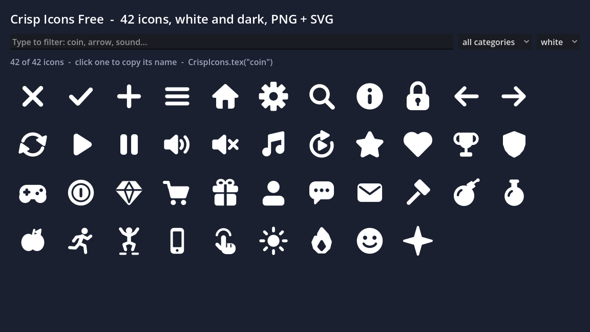

# Crisp Icons Free

42 game and app icons in one rounded, bold style - interface, arrows, media, game states, economy, social, items, food,
actions, devices, nature, faces and shapes - in **white** and **dark**, as **64 px PNG** and **SVG**. Plus `CrispIcons`, a small
helper that finds an icon by name (`CrispIcons.tex("coin")`), and an icon browser scene to search them.
It is the free sampler of [Crisp Icons](https://anipixels.itch.io/crisp-icons).



## Install

**From the Asset Library (inside Godot):** open the **AssetLib** tab, search for "Crisp Icons Free", press **Download**, then **Install**.
Everything lands in `res://addons/crisp_icons_free/`.

**By hand:** download this repository (or `git clone` it) and copy the `addons/crisp_icons_free` folder into your project,
so that it sits at `res://addons/crisp_icons_free`. The scenes and resources point at that path, so keep the folder name.

To try the demo, open `res://addons/crisp_icons_free/demo/icon_browser.tscn` and press **Run Current Scene** (F6).
A `git clone` of this repository also opens as a Godot project of its own and runs the demo with F5
(zip downloads leave `project.godot` out on purpose, so they contain only the `addons/` folder).

## Use

```gdscript
$ShopButton.icon = CrispIcons.tex("cart")                  # white icon, tinted by the button's icon colours
$Hud/Coin.texture = CrispIcons.tex("coin", "dark")         # dark variant, for light backgrounds
$Hud/Heart.texture = CrispIcons.tex("heart")
$Hud/Heart.modulate = Color("ff5a6e")                      # white icons recolour cleanly with modulate

for name in CrispIcons.names("media"):                     # play, pause, sound_on, sound_off, music
    print(name, " ", CrispIcons.path(name))
```

`CrispIcons` is registered with `class_name`, so it works from any script without a preload. It also has `has(name)`,
`svg_path(name, variant)`, `categories()`, `ICONS` (name -> category) and `KEYWORDS` (name -> search words, from `manifest.json`).
You can of course drag the PNGs straight into the Inspector instead.

The SVGs are imported by Godot as textures too (64 x 64 at the default import scale). For a sharper large icon, select an SVG,
raise **Scale** in the Import dock (2 = 128 px, 4 = 256 px) and press **Reimport**; or use the SVGs outside Godot.

If you later install the full pack, delete this folder first: the full pack defines the same `CrispIcons` class name.

## What is in it

| Folder (category) | Icons |
|---|---|
| `interface` | `close`, `check`, `plus`, `menu`, `home`, `settings`, `search`, `info`, `lock` |
| `arrows` | `arrow_left`, `arrow_right`, `refresh` |
| `media` | `play`, `pause`, `sound_on`, `sound_off`, `music` |
| `game` | `restart`, `star`, `heart`, `trophy`, `shield`, `gamepad` |
| `economy` | `coin`, `gem`, `cart`, `gift` |
| `social` | `user`, `chat`, `mail` |
| `items` | `hammer`, `bomb`, `potion` |
| `food` | `apple` |
| `actions` | `run`, `jump` |
| `devices` | `phone`, `tap` |
| `nature` | `sun`, `fire` |
| `faces` | `face_smile` |
| `shapes` | `sparkle` |

Every icon is drawn on a 64-unit grid with half-unit steps and stays readable at 24 px. White icons are plain white on
transparent, so `modulate` or a theme's icon colours recolour them; PNGs are straight-alpha RGBA. Names are unique across
categories, so an icon is found by its name alone. 84 PNGs and 84 SVGs; files (174, 150 KB):

- `./` - `LICENSE.txt`, `README.md`, `crisp_icons.gd`, `manifest.json`
- `demo/` - `icon_browser.gd`, `icon_browser.tscn`
- `icons/dark/actions/` - `jump.png`, `run.png`
- `icons/dark/arrows/` - `arrow_left.png`, `arrow_right.png`, `refresh.png`
- `icons/dark/devices/` - `phone.png`, `tap.png`
- `icons/dark/economy/` - `cart.png`, `coin.png`, `gem.png`, `gift.png`
- `icons/dark/faces/` - `face_smile.png`
- `icons/dark/food/` - `apple.png`
- `icons/dark/game/` - `gamepad.png`, `heart.png`, `restart.png`, `shield.png`, `star.png`, `trophy.png`
- `icons/dark/interface/` - `check.png`, `close.png`, `home.png`, `info.png`, `lock.png`, `menu.png`, `plus.png`, `search.png`, `settings.png`
- `icons/dark/items/` - `bomb.png`, `hammer.png`, `potion.png`
- `icons/dark/media/` - `music.png`, `pause.png`, `play.png`, `sound_off.png`, `sound_on.png`
- `icons/dark/nature/` - `fire.png`, `sun.png`
- `icons/dark/shapes/` - `sparkle.png`
- `icons/dark/social/` - `chat.png`, `mail.png`, `user.png`
- `icons/white/actions/` - `jump.png`, `run.png`
- `icons/white/arrows/` - `arrow_left.png`, `arrow_right.png`, `refresh.png`
- `icons/white/devices/` - `phone.png`, `tap.png`
- `icons/white/economy/` - `cart.png`, `coin.png`, `gem.png`, `gift.png`
- `icons/white/faces/` - `face_smile.png`
- `icons/white/food/` - `apple.png`
- `icons/white/game/` - `gamepad.png`, `heart.png`, `restart.png`, `shield.png`, `star.png`, `trophy.png`
- `icons/white/interface/` - `check.png`, `close.png`, `home.png`, `info.png`, `lock.png`, `menu.png`, `plus.png`, `search.png`, `settings.png`
- `icons/white/items/` - `bomb.png`, `hammer.png`, `potion.png`
- `icons/white/media/` - `music.png`, `pause.png`, `play.png`, `sound_off.png`, `sound_on.png`
- `icons/white/nature/` - `fire.png`, `sun.png`
- `icons/white/shapes/` - `sparkle.png`
- `icons/white/social/` - `chat.png`, `mail.png`, `user.png`
- `svg/dark/actions/` - `jump.svg`, `run.svg`
- `svg/dark/arrows/` - `arrow_left.svg`, `arrow_right.svg`, `refresh.svg`
- `svg/dark/devices/` - `phone.svg`, `tap.svg`
- `svg/dark/economy/` - `cart.svg`, `coin.svg`, `gem.svg`, `gift.svg`
- `svg/dark/faces/` - `face_smile.svg`
- `svg/dark/food/` - `apple.svg`
- `svg/dark/game/` - `gamepad.svg`, `heart.svg`, `restart.svg`, `shield.svg`, `star.svg`, `trophy.svg`
- `svg/dark/interface/` - `check.svg`, `close.svg`, `home.svg`, `info.svg`, `lock.svg`, `menu.svg`, `plus.svg`, `search.svg`, `settings.svg`
- `svg/dark/items/` - `bomb.svg`, `hammer.svg`, `potion.svg`
- `svg/dark/media/` - `music.svg`, `pause.svg`, `play.svg`, `sound_off.svg`, `sound_on.svg`
- `svg/dark/nature/` - `fire.svg`, `sun.svg`
- `svg/dark/shapes/` - `sparkle.svg`
- `svg/dark/social/` - `chat.svg`, `mail.svg`, `user.svg`
- `svg/white/actions/` - `jump.svg`, `run.svg`
- `svg/white/arrows/` - `arrow_left.svg`, `arrow_right.svg`, `refresh.svg`
- `svg/white/devices/` - `phone.svg`, `tap.svg`
- `svg/white/economy/` - `cart.svg`, `coin.svg`, `gem.svg`, `gift.svg`
- `svg/white/faces/` - `face_smile.svg`
- `svg/white/food/` - `apple.svg`
- `svg/white/game/` - `gamepad.svg`, `heart.svg`, `restart.svg`, `shield.svg`, `star.svg`, `trophy.svg`
- `svg/white/interface/` - `check.svg`, `close.svg`, `home.svg`, `info.svg`, `lock.svg`, `menu.svg`, `plus.svg`, `search.svg`, `settings.svg`
- `svg/white/items/` - `bomb.svg`, `hammer.svg`, `potion.svg`
- `svg/white/media/` - `music.svg`, `pause.svg`, `play.svg`, `sound_off.svg`, `sound_on.svg`
- `svg/white/nature/` - `fire.svg`, `sun.svg`
- `svg/white/shapes/` - `sparkle.svg`
- `svg/white/social/` - `chat.svg`, `mail.svg`, `user.svg`

## Full pack

**[Crisp Icons on itch.io](https://anipixels.itch.io/crisp-icons)** has **590 icons** - these 42 and 548 more - in 13 categories, in white, dark and as
coloured badges in 8 colours, as PNG at 32, 64, 128 and 256 px plus SVG, with sprite-sheet atlases, a searchable icon browser and a
Godot 4 project with the same `CrispIcons` helper.

Or get every Crisp pack in one bundle: [Crisp Everything Bundle](https://itch.io/s/203391/crisp-everything-bundle).

## Godot version

Written for **Godot 4.3 and newer** (GDScript only, no C#, no GDExtension, no feature known to need 4.4 or later).
Tested on **Godot 4.7.2 stable (the .NET editor build, run headless on Windows 11)**: headless import plus a script that loads every file and exercises the public API,
with no errors or warnings. It has **not** been run on 4.3 - 4.6; if something misbehaves there, please open an issue.

The demo scene was also rendered once in a real window to make `screenshot.png`.

## Licence

This free repository has two licences, both standard and both fine for commercial games:

- **Assets** - the icons (PNG and SVG), manifest.json and the demo scene (.tscn) - are under **Creative Commons Attribution 4.0 International (CC BY 4.0)**.
  Use, edit and ship them in anything, including commercial projects, as long as you give credit.
  A line like this in your credits is enough: `Crisp Icons Free by Anipixels - https://anipixels.itch.io/crisp-icons`
- **Code** - every `.gd` file - is under the **MIT licence**.

See `LICENSE` (assets) and `LICENSE-CODE` (code); a copy of both is in `addons/crisp_icons_free/LICENSE.txt`.
This applies to the files in this repository only. The paid full pack has its own licence (no attribution needed, no redistribution).

## How it was made

The icons are generated procedurally by code written with an AI assistant (Claude). No AI image or audio generators were used, and nothing is traced or taken from third-party assets.
